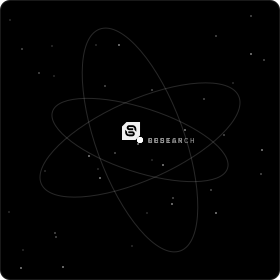
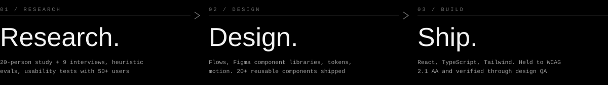
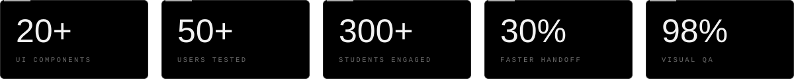
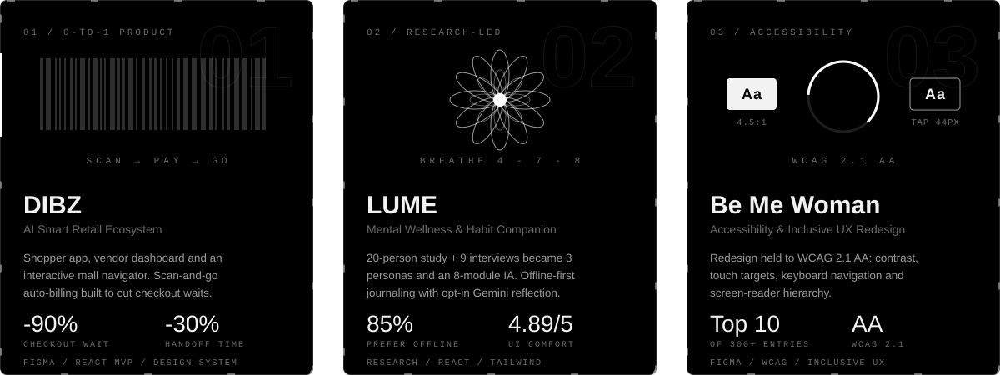

 

 

<table>
<tr>
<td valign="middle">

Hey, I'm **Gourav**. I design products and then build them: research and information architecture, high-fidelity prototypes, design tokens, and the React that makes them real. What ships matches what was designed.

- **Studying** B.Tech in Computer Science & Engineering, Shaheed Bhagat Singh State University (2027)
- **Leading** UI/UX & Design Lead at Google Developer Groups on Campus
- **Focus** 0-to-1 products, design systems, accessibility (WCAG 2.1 AA), motion
- **Workflow** AI-assisted prototyping to get from idea to interactive faster
- **Open to** design / frontend internships, freelance and collaborations

</td>
<td width="280" align="center">

</td>
</tr>
</table>

  

 

  

 

<b>Project details</b>

 

| Project | What I did | Outcome |
|---|---|---|
| **DIBZ** | Owned 0-to-1 design for a shopper mobile app, vendor dashboard and interactive mall navigation. Built the brand identity, Figma design system, token docs and a React MVP. | Scan-and-go auto-billing flow aimed at up to 90% shorter checkout waits; 30% faster handoff |
| **LUME** | 20-participant study and 9 interviews into 3 personas, journey maps and an 8-module IA. Designed the Electric Lavender token system, custom SVG mandalas, 1-tap mood check-in, 12-week heatmap, Write/Doodle canvas and 4-7-8 breathing flows. Built in React + Tailwind with opt-in Gemini reflection. | 85% preferred offline storage; 4.89/5 UI comfort |
| **Be Me Woman** | Accessibility-first redesign against WCAG 2.1 AA: contrast, touch targets, keyboard navigation, screen-reader hierarchy. | Top 10 of 300+ global entries |

 

DESIGN 

FRONTEND 

BACKEND & LANGUAGES 

AI WORKFLOW 

 

 

| | Role | When | Highlights |
|---|---|---|---|
| **Google Developer Groups on Campus, SBSSU** | UI/UX & Design Lead | Aug 2025 - Nov 2026 | Visual design and brand across 10+ workshops and hackathons; +40% engagement across 300+ participants; Figma campaign system lifted registrations 35%; mentored 3 designers |
| **Unison Flow** | Product & UI/UX Design Intern | Oct - Dec 2025 | Testing with 50+ users, 15+ UX bottlenecks resolved; owned UX/UI for 3 modules (+25% task efficiency); cut frontend rework 20% |
| **Solitaire Infosys** | UI Engineer & React.js Intern | Jul - Aug 2025 | 98% visual QA accuracy, 100% feature parity in UAT; +30% operator task speed; 40+ UI bugs fixed. **Best Intern Award** |
| **Shadowfox** | Web UI & Frontend Intern | May - Jun 2025 | 6+ React data-viz components for a 500+ user dashboard; 18% faster load; +25 Lighthouse points |

<b>Recognition</b>

 

| | |
|---|---|
| **Featured Portfolio**, BestPortfolio (Nov 2026) | Homepage feature for interactive UI/UX craft and design systems execution |
| **Best Intern**, Solitaire Infosys (Aug 2025) | #1 among 20+ interns for UI engineering velocity and design QA |
| **Top 10 Global Finalist**, Be Me Woman Redesign | 300+ entries, recognized for WCAG 2.1 AA compliance |
| **Team Member Award**, GDG on Campus SBSSU (Nov 2026) | Campus-wide design workflows, +40% visual branding engagement |

 

 

  

 

the mountains in the banner are my last 52 weeks of commits. refreshed automatically.

